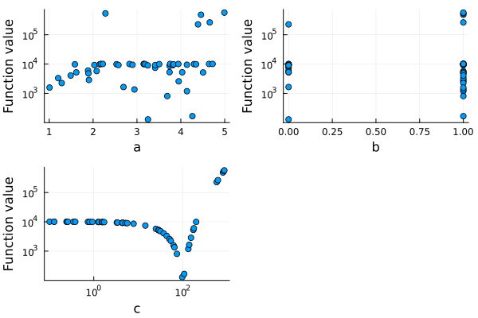

# Hyperopt

[](https://github.com/baggepinnen/Hyperopt.jl/actions/workflows/ci.yml?query=branch%3Amaster)
[](https://codecov.io/gh/baggepinnen/Hyperopt.jl)
[](https://baggepinnen.github.io/Hyperopt.jl/stable/)
[](https://baggepinnen.github.io/Hyperopt.jl/dev/)


A package to perform hyperparameter optimization. Currently supports
- random search,
- [Latin hypercube sampling](https://en.wikipedia.org/wiki/Latin_hypercube_sampling), with continuous and categorical hyperparameters,
- [Hyperband](https://arxiv.org/abs/1603.06560), which evaluates many configurations with a small budget and the most promising configurations with larger budgets,
- [BOHB](https://arxiv.org/abs/1807.01774), which combines Hyperband with model-based sampling of the configurations.

The [documentation](https://baggepinnen.github.io/Hyperopt.jl/stable/) contains executed examples of all samplers, the function interface, multi-start optimization with Optim.jl and plotting, as well as the API reference. If you use Hyperopt.jl in academic work, please cite it using the entry in [CITATION.bib](CITATION.bib).

# Usage

This package was designed to facilitate the addition of optimization logic to already existing code. I usually write some code and try a few hyperparameters by hand before I realize I have to take a more structured approach to finding good hyperparameters. I therefore designed this package such that the optimization logic is wrapped around existing code, and the user only has to specify which variables to optimize and candidate values (ranges) for these variables.

## High-level example
In order to add hyperparameter optimization to the existing pseudo code
```julia
a = manually_selected_value
b = other_value
cost = train_model(a,b)
```
we wrap it in `@hyperopt` like this
```julia
ho = @hyperopt for i = number_of_samples,
                   a = candidate_values,
                   b = other_candidate_values
cost = train_model(a,b)
end
```

## Details

1. The macro `@hyperopt` takes a for-loop with an initial argument determining the number of samples to draw (`i` below). With `Hyperband`, the initial argument holds the budget of each evaluation instead, and its value is the maximum budget, see [Hyperband](#hyperband).
2. The sample strategy is selected with the special keyword `sampler = Sampler(opts...)`. Available options are `RandomSampler()`, `LHSampler()`, `CLHSampler(dims=[Continuous(), Categorical(2), Continuous(), ...])` and `Hyperband(η=3, inner=RandomSampler())`.
3. The subsequent arguments to the for-loop specify names and candidate values for different hyperparameters (`a = LinRange(1,5,1000), b = [true, false], c = exp10.(LinRange(-1,3,1000))` below).
4. Log-uniform sampling is obtained with a logarithmically spaced candidate vector, e.g., `c = exp10.(LinRange(-1,3,1000))`.
5. In the example below, the parameters `i,a,b,c` can be used within the expression sent to the macro and they will hold a new value sampled from the corresponding candidate vector each iteration. The value of the expression is the result of the iteration, which is to be minimized.
6. An optimization is resumed by passing the existing `Hyperoptimizer` with the special keyword `ho`, e.g., `@hyperopt for i=20, ho=ho, a = LinRange(1,5,1000), ...`. The new samples and results are appended to `ho.history` and `ho.results`. The sampler of the existing `Hyperoptimizer` is continued, including the state of its random number generator. A sampler given in the resumed call is not used, and a warning is emitted if it is of another type than the existing sampler.

The resulting object `ho::Hyperoptimizer` holds all the sampled parameters and function values and has `minimum/minimizer` and `maximum/maximizer` properties (e.g., `ho.minimizer`). A `NaN` result is treated as `Inf` by `minimum/minimizer` and as `-Inf` by `maximum/maximizer`. The `Hyperoptimizer` can also be plotted using `plot(ho)` (uses `Plots.jl`). See the docstrings of `@hyperopt` and `Hyperoptimizer` and the [documentation](https://baggepinnen.github.io/Hyperopt.jl/stable/) for details.


## Full example
```julia
using Hyperopt

f(x,a,b=true;c=10) = sum(@. x + (a-3)^2 + (b ? 10 : 20) + (c-100)^2) # Function to minimize

# Main macro. The first argument to the for loop is interpreted as the number of iterations (for Hyperband, as the maximum budget)
ho = @hyperopt for i=50,
            sampler = RandomSampler(), # This is default if none provided
            a = LinRange(1,5,1000),
            b = [true, false],
            c = exp10.(LinRange(-1,3,1000))
   print(i, "\t", a, "\t", b, "\t", c, "   \t")
   x = 100
   @show f(x,a,b,c=c)
end
1	2.1771771771771773	false	0.2445616683452446   	f(x, a, b, c = c) = 10071.824514138334
2	4.643643643643644	true	0.26328154656480207   	f(x, a, b, c = c) = 10060.114572287093
3	4.1391391391391394	true	132.7770829355429   	f(x, a, b, c = c) = 1185.6348037417756
4	4.45945945945946	true	794.145171902934   	f(x, a, b, c = c) = 481949.6496980675
5	3.5065065065065064	true	0.9310413487069078   	f(x, a, b, c = c) = 9924.915117092753
⋮
50	3.754754754754755	true	0.12945299782279157   	f(x, a, b, c = c) = 10084.695813253911
Hyperoptimizer with
  a length: 1000
  b length: Bool[1, 0]
  c length: 1000
  minimum / maximum: (128.7764050750981, 570037.3595670203)
  minimizer:
        a         b         c
     3.25         0     97.05


julia> best_params, min_f = ho.minimizer, ho.minimum
(Real[3.25025025025025, false, 97.04808877380302], 128.7764050750981)

julia> printmin(ho)
a = 3.25025025025025
b = false
c = 97.04808877380302
```
The samples are random, the printed values therefore differ between runs.

We can also visualize the result by plotting the hyperoptimizer
```julia
using Plots
plot(ho)
```


This may allow us to determine which parameters are most important for the performance etc.

## Progress meters
`@hyperopt`, `hyperband` and `hyperoptim` display a progress meter. The progress meters are disabled by
```julia
Hyperopt.SHOW_PROGRESS[] = false
```

## Manual iteration
The type `Hyperoptimizer` is iterable, it iterates for the specified number of iterations, each iteration providing a sample of the parameter vector. Each iteration appends the sample to `ho.history`; the result of each sample is to be appended to `ho.results` by the caller:
```julia
ho = Hyperoptimizer(10, a = LinRange(1,2,50), b = [true, false], c = randn(100))
for (i,a,b,c) in ho
    res = computations(a,b,c)
    push!(ho.results, res)
end
```
See the [documentation](https://baggepinnen.github.io/Hyperopt.jl/stable/function_interface/) for the semantics of repeated iteration.

# Categorical variables
`RandomSampler` and `CLHSampler` support categorical variables which do not have a natural floating point representation, such as functions. For `CLHSampler`, a categorical variable with `n` candidates is declared as `Categorical(n)` or, equivalently, `UnorderedCategorical(n)`; both are treated as unordered:
```julia
@hyperopt for i=20, fun = [tanh, sin, cos]
    fun(1.0)
end
# or
@hyperopt for i=20, sampler=CLHSampler(dims=[Categorical(3), Continuous()]),
                    fun   = [tanh, sin, cos],
                    param = LinRange(0,1,20)
    fun(param)
end
```

# Which sampler to use?
`RandomSampler` is a good baseline and the default if none is chosen. `Hyperband(η=3, inner=RandomSampler())` runs the expression with varying amount of resources, allocating more resources to promising hyperparameters. See below for more info on `Hyperband`.

If the number of iterations is small, `LHSampler` works better than random search. `LHSampler` evaluates an optimized [Latin hypercube](https://en.wikipedia.org/wiki/Latin_hypercube_sampling) plan, in which every candidate of each hyperparameter occurs exactly once. Caveat: `LHSampler` needs all candidate vectors to be of equal length, i.e.,
```julia
hob = @hyperopt for i=100, sampler = LHSampler(),
                            a = LinRange(1,5,100),
                            b = repeat([true, false],50),
                            c = exp10.(LinRange(-1,3,100))
    f(100,a,b,c=c)
end
```
where all candidate vectors are of length 100. The candidates for `b` thus had to be repeated 50 times.

The categorical `CLHSampler` circumvents this
```julia
hob = @hyperopt for i=100,
                    sampler=CLHSampler(dims=[Continuous(), Categorical(2), Continuous()]),
                    a = LinRange(1,5,100),
                    b = [true, false],
                    c = exp10.(LinRange(-1,3,100))
    f(100,a,b,c=c)
end
```
Here, each candidate of `b` occurs in 50 points of the plan, and the plan distributes the points with `b = true`, as well as those with `b = false`, over the ranges of `a` and `c`.

Both samplers accept the keyword arguments `rng`, the random number generator from which the plans are drawn, e.g., `LHSampler(rng=Xoshiro(0))` for a reproducible plan, and `steps`, the number of proposed exchanges of entries in the optimization of the plan, see the docstring of `LHSampler`. Every run, including a resumed run with `ho = ...`, evaluates a new plan, whose points are chosen such that they do not coincide with configurations that were evaluated before, if possible.


## Hyperband
`Hyperband(η=3, inner=RandomSampler())` implements [Hyperband: A Novel Bandit-Based Approach to Hyperparameter Optimization](https://arxiv.org/abs/1603.06560). Hyperband evaluates configurations of the hyperparameters with a small budget, i.e., amount of resources, and evaluates the configurations with the smallest losses again with a larger budget. The maximum budget is `R`, and the parameter `η` determines the proportion of configurations that are discarded in each round of successive halving: the fraction `1/η` of the configurations is evaluated again with `η` times the budget. How to interpret the budget is entirely up to the user - it can be a time limit, the number of training epochs, the maximum number of iterations, or anything else.

With `Hyperband`, the first argument of the for loop names the variable that holds the budget of the current evaluation, and its value is the maximum budget `R`. The expression inside the `@hyperopt` macro takes the form of the following pseudocode
```julia
ho = @hyperopt for resources = 50, sampler = Hyperband(η=3, inner=RandomSampler()), a = LinRange(1,5,1800), c = exp10.(LinRange(-1,3,1800))
    if state === nothing # The first evaluation of the configuration (a, c)
        model = create_model(a, c)
    else                 # The configuration (a, c) is evaluated again with a larger budget
        model = state    # Continue from the state returned by the previous evaluation
    end
    train!(model, resources)
    loss(model), model   # Return the loss and a state from which the training can be continued
end
```
- In every evaluation, the hyperparameter variables (`a` and `c` above) hold the configuration that is evaluated, and `resources` holds its budget.
- `state` is `nothing` in the first evaluation of a configuration. When a configuration is evaluated again with a larger budget, `state` is the state returned by its previous evaluation. The state can be any object, e.g., the weights of a neural network together with the state of its optimizer. Hyperopt does not interpret the state.
- The loop body returns `(loss, state)`. If it returns only the loss, `state` is `nothing` in every evaluation, i.e., every evaluation starts from the beginning.

The resulting `Hyperoptimizer` records the configuration, the loss and the budget of each evaluation in `ho.history`, `ho.results` and `ho.sampler.budgets`, respectively. Since losses obtained with different budgets are not comparable, `ho.minimum`, `ho.minimizer`, `ho.maximum`, `ho.maximizer` and `printmin(ho)` consider only the evaluations with the largest budget. `ho.sampler.minimum` is the named tuple `(; loss, budget, state, configuration)` of the evaluation that attains `ho.minimum`; in the example above, `ho.sampler.minimum.state` is the trained model of the best configuration. `plot(ho)` shows the results of each budget as a separate series.

If `R` is also given to `Hyperband` and differs from the value of the first loop argument, `R` of the sampler is used and a deprecation warning is emitted. In versions before v0.6, the value of the first loop argument was ignored.

A (simple) working example using `Hyperband` and Optim is given below, where the budget is the maximum number of calls to the objective function, and the state is the minimizer found so far:
```julia
using Optim
f(a;c=10) = sum(@. 100 + (a-3)^2 + (c-100)^2)
hohb = @hyperopt for resources=50, sampler=Hyperband(η=3, inner=RandomSampler()), a = LinRange(1,5,1800), c = exp10.(LinRange(-1,3,1800))
    x0 = state === nothing ? [a, c] : state
    res = Optim.optimize(x->f(x[1],c=x[2]), x0, SimulatedAnnealing(), Optim.Options(f_calls_limit=round(Int, resources)))
    Optim.minimum(res), Optim.minimizer(res)
end
hohb.minimizer             # The initial guess [a, c] from which the smallest value with the largest budget was found
hohb.sampler.minimum.state # The minimizer of f found from this initial guess
plot(hohb)
```

With `inner = LHSampler()` or `inner = CLHSampler(dims=[...])`, the configurations of all brackets of a run are distinct points of a Latin hypercube plan, which contains one point per element of the candidate vectors. The candidate vectors must therefore contain at least as many elements as a run of Hyperband draws configurations (`ho.iterations`); otherwise, an error that states the required number is thrown.

The function `hyperband(f, candidates; R, η, inner)` runs Hyperband without the macro, and `hyperoptim` applies it to multi-start optimization with Optim.jl, see the [documentation](https://baggepinnen.github.io/Hyperopt.jl/stable/function_interface/).

## BOHB
[BOHB: Robust and Efficient Hyperparameter Optimization at Scale](https://arxiv.org/abs/1807.01774) refines Hyperband by replacing the random sampler by a sampler based on Bayesian optimization. It is used by replacing the inner sampler of `Hyperband` by `BOHB(dims=[<dims>...])`, where `dims` contains one dimension type per hyperparameter:
```julia
using Optim
f(a;c=10) = sum(@. 100 + (a-3)^2 + (c-100)^2)
bohb = @hyperopt for resources=50, sampler=Hyperband(η=3, inner=BOHB(dims=[Continuous(), Continuous()])), a = LinRange(1,5,800), c = exp10.(LinRange(-1,3,1800))
    x0 = state === nothing ? [a, c] : state
    res = Optim.optimize(x->f(x[1],c=x[2]), x0, NelderMead(), Optim.Options(f_calls_limit=round(Int, resources)))
    Optim.minimum(res), Optim.minimizer(res)
end
```

When using BOHB, a Kernel Density Estimator will estimate hyperparameters that balance exploration and exploitation based on previous observations. The estimated hyperparameters are evaluated as a new configuration, i.e., they are assigned to the hyperparameter variables (`a` and `c` in the previous example) and `state === nothing`. The observations are the evaluated configurations, i.e., the values of the hyperparameters, and their losses. The state returned by the loop body is not used by BOHB and can be any object.

The keyword argument `dims` contains one dimension type per hyperparameter, in the order of the candidate vectors:
- `Continuous()` for ordered, real-valued hyperparameters, including integer-valued ones. The densities are estimated in the coordinate given by the index into the sorted candidate vector, scaled to [0, 1]. A log-spaced candidate vector such as `exp10.(LinRange(-1,3,1800))` is thus modeled in a logarithmic coordinate.
- `Categorical(n)` or `UnorderedCategorical(n)` for categorical hyperparameters with `n` candidates, e.g., `UnorderedCategorical(3)` for `fun = [tanh, σ, relu]`. Both types are treated as unordered.

Every configuration proposed by BOHB consists of elements of the candidate vectors. All random decisions of BOHB use the RNG of its random sampler, a run is thus reproducible with, e.g., `BOHB(dims=[Continuous(), Continuous()], random_sampler=RandomSampler(MersenneTwister(0)))`. See the docstring of `BOHB` for the remaining parameters.

# Parallel execution
- The macro `@phyperopt` works in the same way as `@hyperopt` but distributes the evaluations of the loop body over the worker processes with `Distributed.pmap`. The functions that the loop body calls must be defined on all workers, e.g., with `@everywhere`.
- The macro `@thyperopt` evaluates the loop body in `Threads.nthreads()` tasks spawned with `Threads.@spawn`. The loop body must be safe to evaluate concurrently, and the memory consumption increases with the number of concurrent evaluations.

```julia
using Distributed
addprocs(4)
@everywhere using Hyperopt
@everywhere cost(a, b) = (a - 3)^2 + (b ? 10 : 20)
ho = @phyperopt for i = 100, a = LinRange(1, 5, 1000), b = [true, false]
    cost(a, b)
end
```

Both macros draw all configurations from the sampler on the calling process before the evaluations start. A worker receives the iteration index and the configuration of an evaluation and returns only the result, so the amount of data transferred per evaluation does not depend on the number of evaluations. The evaluations are recorded in `ho.history` and `ho.results` in the order of the iterations, with the same types as by `@hyperopt`; with a seeded sampler, e.g., `RandomSampler(Xoshiro(0))`, the parallel macros record the same configurations as `@hyperopt`. A run can be continued with `ho = existing_ho`, as with `@hyperopt`.

`@phyperopt` accepts an optional second argument, a function with the interface of `pmap` that is called as `pmap(f, itr)`, where `itr` is an iterator of unknown length:
```julia
# Evaluations that throw an error are not recorded, the optimization continues
ho = @phyperopt for i = 100, a = LinRange(1, 5, 1000), b = [true, false]
    cost(a, b)
end (f, itr) -> pmap(f, itr; on_error = e -> nothing)

# The function that evaluates the loop body is sent to each worker only once, which reduces the transferred data if
# the loop body refers to large local variables
ho = @phyperopt for i = 100, a = LinRange(1, 5, 1000), b = [true, false]
    cost(a, b)
end (f, itr) -> pmap(f, CachingPool(workers()), itr)
```

Errors and interruptions are handled as follows:
- If the loop body throws an error, no further evaluations are started, and the error is rethrown when the running evaluations have completed. Other tasks on the workers are not interrupted. The results obtained before the error are recorded in the `Hyperoptimizer` given with `ho = existing_ho`, if any.
- An interruption, e.g., by Ctrl-C, stops the optimization: the iteration over the configurations ends, and the `Hyperoptimizer` with the results obtained so far is returned. The evaluations that are running, and with `@phyperopt` at most one configuration that `pmap` has received but not yet sent to a worker, are not interrupted; they complete in the background, and their results are discarded. `Distributed.interrupt()` interrupts the running evaluations, together with any other task that runs on the workers.

With a `Hyperband` sampler, both macros evaluate the configurations of each rung of successive halving in parallel. With `@phyperopt`, a custom `pmap` with `on_error` must return a loss for a failed evaluation, e.g., `on_error = e -> Inf`. The function `hyperband` accepts the keyword argument `mapfun`, e.g., `mapfun = pmap`; `threads = true` corresponds to `mapfun = Hyperopt.tmap`.
